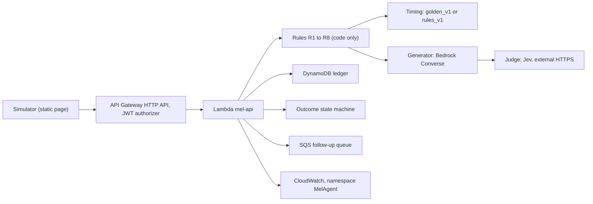

# mel-agent

## Summary

mel-agent is a Monitoring, Evaluation and Learning (MEL) survey agent for FarmerChat.

After a farmer gets advice, mel-agent decides if it should ask a follow-up survey.
If yes, it picks the send window and the channel, writes the survey, checks it, and records the answer.
If no, it records the reason.

Every decision follows a fixed rule set. A language model writes the survey text. A second check (Jev) reviews that text.

> **Status at this commit**
>
> - Results are not in this repository yet. Every number lives in `evidence/REPORT.md`, which is built locally and is gitignored.
> - The end-to-end trace (`evidence/e2e-run-1.md`) is not in this repository yet.
> - See [Known gaps](#known-gaps-at-this-commit) before you present this.

## Architecture



1. An insight from FarmerChat arrives at `POST /surveys/decide`.
2. The caller identity comes only from Cognito token claims: `custom:farmer_id` and `custom:org_id`.
3. Rules R1 to R8 decide survey or no survey. The first match wins. No model is used here.
4. The timing profile sets the send window. The default is `golden_v1`. `rules_v1` stays available.
5. For R8, the generator calls a Bedrock model through the Converse API. Output tokens are capped at 600.
6. A schema check runs on the output. A bounded repair loop retries if the check fails. Our validator sets `schema_valid`. The model does not.
7. Jev checks the survey for injected instructions and for new advice. Jev never writes text.
8. The survey and hand-off go to the DynamoDB ledger. Every read and write uses `org_id` and `farmer_id`.
9. Responses go to `POST /surveys/{survey_id}/responses`. The outcome state machine sets the result. A duplicate response is rejected.
10. Follow-up items go to an SQS queue. Metrics go to CloudWatch under the namespace `MelAgent`.

Insight text, advice text and retrieved text are untrusted data. They go in the user turn of a model call. They never go in a system prompt.

## Repository layout

| Path | What it holds |
|---|---|
| `mel/` | Application package: models, rules, timing, generator, judge, ledger, outcomes, renderers, API |
| `pack/` | Copy of the participant pack. Read only. |
| `tests/` | Offline pytest suite |
| `infra/` | CDK app in Python, six stacks, all named `MelAgent*` |
| `sim/` | Static simulator page. One file, no build step. |
| `models/` | Model candidates, the chosen model file, and eval results |
| `evals/` | Survey eval harness |
| `scripts/` | Day 0 check, Lambda packaging, deploy, seed users |
| `prompts/` | Task prompts for each agent wave |

## Run the tests

You need Python 3.12.

```bash
python3.12 -m venv .venv
.venv/bin/pip install -r requirements.txt
make test     # offline. Sockets are blocked. No AWS or Jev call is made.
make lint     # ruff on mel/ and tests/
make golden   # prints the rule table against the golden set
```

Tests never call real APIs. `make test` blocks the network.

## Configuration

The app reads these environment variables. If one is unset, it reads the SSM parameter under `/mel/` with the same suffix.

`MEL_REGION`, `MEL_TABLE`, `MEL_ARTIFACTS_BUCKET`, `MEL_FOLLOWUP_QUEUE_URL`, `MEL_JEV_SECRET_ARN`, `MEL_USER_POOL_ID`, `MEL_USER_POOL_CLIENT_ID`, `MEL_MODELS_FILE`, `MEL_METRICS_NAMESPACE`

Secrets are never in the repository. The Jev key lives in Secrets Manager.

## Deploy

Deploy needs AWS credentials for `us-west-2` and the CDK CLI. Read [`infra/INFRA.md`](infra/INFRA.md) first. It holds the stack names, endpoints and the exact commands.

| Task | Command |
|---|---|
| Lambda code only | `bash scripts/package_lambda.sh` then `bash scripts/deploy.sh --lambda-only` |
| Container for AgentCore Runtime | `python infra/runtime.py` |
| Full deployment | `bash scripts/deploy.sh` |

Put the Jev key into Secrets Manager by hand. Do not commit it.

## Out of scope

- Real delivery to any channel: app push, web, WhatsApp, Telegram or voice. The simulator shows rendered text only.
- Hindi (`hi-IN`). The settings list only `en-IN`. Hindi is a stretch goal.
- An Android app.
- Live farmer data. Evidence uses only the six pack scenarios.

## Known gaps at this commit

- `mel/agent.py` (the AgentCore entrypoint) and `mel/api/handler.py` (the Lambda handler) are not on `main` yet. The integration step adds them.
- The simulator calls `POST /surveys/{id}/events` and `GET /follow-ups`. No route for either exists in `mel/api` yet. See `sim/README.md`.
- `evidence/` is gitignored. `evidence/REPORT.md` and `evidence/e2e-run-1.md` are built on the operator's machine.
- `KNOWN-ISSUES.md` is not in the repository yet.

## More

- Demo steps: [`DEMO.md`](DEMO.md)
- Simulator: [`sim/README.md`](sim/README.md)
- Infrastructure: [`infra/INFRA.md`](infra/INFRA.md)
- Contracts between modules: [`CONTRACTS.md`](CONTRACTS.md)
